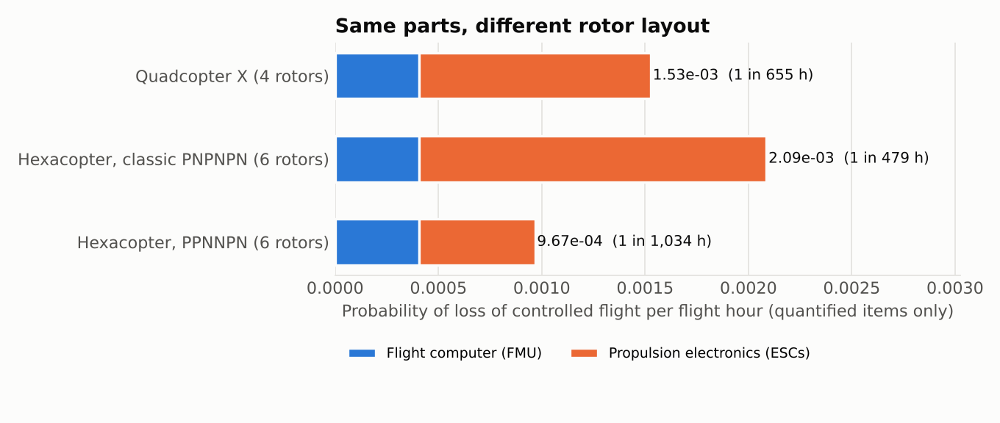

# Analisis Keselamatan Hexacopter — dari BOM ke probabilitas

[🇬🇧 English](README.md) · **🇮🇩 Bahasa Indonesia**

Proyek ini adalah **fault tree analysis** dari atas ke bawah (top-down) untuk hazard *hilangnya kendali terbang* (loss of controlled flight) pada drone multirotor. Setiap angka bisa ditelusuri ke **bill of materials (BOM) publik** dan metode **parts count MIL-HDBK-217F**. Data yang belum tersedia dicatat sebagai **open item**, bukan ditebak.

**▶ Demo: https://rendynoa.github.io/hexacopter-safety-analysis/**  ·  📄 [Laporan lengkap (EN)](docs/report.md)



## Temuan utama (Rev A)

| Layout | P(hilang kendali) per jam terbang* | vs quad |
|---|---|---|
| Quad X | 1,53 × 10⁻³ | 1,00× |
| Hexacopter PNPNPN (klasik) | 2,09 × 10⁻³ | **1,37×** |
| Hexacopter PPNNPN | 9,67 × 10⁻⁴ | **0,63×** |

\*Hanya item yang sudah terkuantifikasi: flight computer + ESC, komponen kelas komersial, lingkungan ARW. Motor, propeller, baterai, dan sensor MEMS masih open item, jadi nilai sebenarnya lebih tinggi.

1. **Rotor lebih banyak tidak otomatis lebih aman.** Hexacopter PNPNPN klasik tidak bisa tetap terkendali penuh setelah satu rotor mana pun gagal, sehingga keenam ESC-nya menjadi enam single point of failure.
2. **Rotor yang sama, cukup disusun ulang menjadi PPNNPN, menurunkan probabilitas 54%.** Syaratnya, software terbang harus bisa mendeteksi kegagalan dan mengatur ulang kendali (SR-02).
3. **Urutan hasil ini tetap sama berapa pun nilai data motor/propeller yang belum ada.** Ini sudah diuji untuk rentang 0–1.000 kegagalan per 10⁶ jam.
4. **Pada PPNNPN, flight computer menjadi kontributor terbesar (42%)**, jadi itu target perbaikan berikutnya.
5. **Komponen pasif paling dominan.** Kapasitor keramik dan resistor chip menyumbang 72–81% laju kegagalan tiap board, dan kelas kualitas komponen mengubah hasil sekitar 8–9× (faktor π_Q MIL-HDBK-217F).

## Metode singkat

- **Level 1:** hazard dan dampaknya ke manusia, lingkungan, dan drone
- **Level 2:** fungsi subsistem (komputasi terbang, sensor attitude, daya, gaya dorong). Level ini belum butuh BOM.
- **Level 3:** BOM nyata, yaitu board FMU Pixhawk FMUv3 (148 komponen) dan ESC Sapog (86 komponen), dihitung dengan λ_part = N · λ_g · π_Q
- **Laju kegagalan → probabilitas:** P = 1 − e^(−λt), dengan asumsi laju kegagalan konstan (fase masa pakai normal pada kurva bak mandi)

## Menjalankan

```bash
pip install -r requirements.txt
python run_analysis.py
python -m pytest -q
```

## Catatan penting

- **Sudah diverifikasi:** setiap nilai λ_g dan π_Q sudah dicek baris per baris dengan MIL-HDBK-217F Notice 2 Appendix A, dan nomor halamannya dicatat di `data/mil217f_partscount_ARW.csv`.
- Parts count menganggap semua komponen kritis, jadi hasilnya batas atas. Langkah berikutnya adalah FMEDA.

## 🤖 Proses pembuatan

Dibuat dengan bantuan AI (Claude). Arah proyek, cakupan, serta pemeriksaan metode dan hasil dilakukan oleh saya. Proyek ini berangkat dari masukan pewawancara atas analisis hazard kualitatif saya sebelumnya: *jangan berasumsi, gunakan data komponen, mulai fault tree dari atas, dan tunjukkan bagaimana probabilitas hazard diturunkan.*
