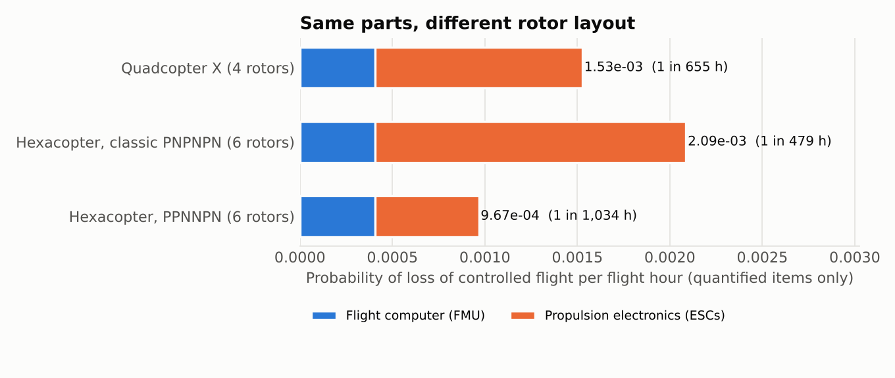

# Hexacopter Safety Analysis — from BOM to probability

**🇬🇧 English** · [🇮🇩 Bahasa Indonesia](README.id.md)

A top-down **fault tree analysis** of *loss of controlled flight* for a multirotor drone. Every number is traced to a **public bill of materials** and the **MIL-HDBK-217F parts count** method. Data that does not exist yet is kept as an **open item**, never guessed.

**▶ Live demo: https://rendynoa.github.io/hexacopter-safety-analysis/**  ·  📄 [Full report](docs/report.md)



## Key findings (Rev A)

| Layout | P(loss of control) per flight hour* | vs quad |
|---|---|---|
| Quad X | 1.53 × 10⁻³ | 1.00× |
| Hexacopter, classic PNPNPN | 2.09 × 10⁻³ | **1.37×** |
| Hexacopter, PPNNPN | 9.67 × 10⁻⁴ | **0.63×** |

\*Quantified items only: flight computer + ESCs, commercial parts, MIL-HDBK-217F environment ARW. Motors, propellers, battery and MEMS sensors are open items, so the real value is higher.

1. **More rotors is not automatically safer.** A classic PNPNPN hexacopter cannot stay fully controllable after any single rotor loss, so its six ESCs are six single points of failure.
2. **Rearranging the same six rotors (PPNNPN) cuts the probability by 54%.** This requires the flight software to detect the failure and re-allocate control (SR-02).
3. **The ranking holds whatever the missing motor/propeller data turns out to be.** This is tested from 0 to 1,000 failures per 10⁶ h.
4. **In the PPNNPN layout the flight computer becomes the biggest contributor (42%)**, so it is the next design target.
5. **Passive parts dominate the prediction.** Ceramic capacitors and chip resistors are 72–81% of each board's failure rate, and the component quality grade changes the result by about 8–9× (MIL-HDBK-217F π_Q).

## Method

```
Level 1  Hazard            TE-1 Loss of controlled flight  (people · environment · drone)
Level 2  Functions         flight computing | attitude sensing | propulsion power | thrust
Level 3  Parts             FMU BOM (148 parts) + ESC BOM (86 parts) -> MIL-HDBK-217F parts count
                           motor / propeller / battery / MEMS -> OPEN ITEMS (no data, no guess)
```

- **Failure rate → probability:** P = 1 − e^(−λt), constant failure rate (useful-life part of the bathtub curve)
- **Parts count:** λ_part = N · λ_g · π_Q (environment ARW = airborne, rotary winged)
- **Fault tree:** OR / AND / k-out-of-n gates, minimal cut sets, Birnbaum and Fussell–Vesely importance, Monte Carlo cross-check
- **Rotor-loss tolerance:** taken from published controllability analyses of hexacopters (see the report)

## Data traceability

| File | Content |
|---|---|
| `data/bom_fmu_v3.csv` | Pixhawk FMUv3 REV D BOM, every line mapped to a MIL-HDBK-217F row, with a classification note |
| `data/bom_esc_sapog.csv` | Sapog reference ESC parts (from the open schematic), mapped the same way |
| `data/mil217f_partscount_ARW.csv` | The λ_g and π_Q values used, with their origin |
| `data/open_items.csv` | What is not quantified, why, and how to close it |
| `docs/fmeca.csv` | Failure modes, effects, detection, severity and requirements |

> ✅ **Verified against the handbook.** Every λ_g and π_Q was checked line by line against MIL-HDBK-217F Notice 2, Appendix A, and its page is recorded in `data/mil217f_partscount_ARW.csv`. The first draft came from the open-source RAMSTK tool; the check corrected 10 rows and one quality factor that RAMSTK still carries from before Notice 2.

## Run it

```bash
pip install -r requirements.txt
python run_analysis.py        # results/, figures/ and the data inside index.html
python -m pytest -q           # 8 tests incl. Monte Carlo check and Python-vs-browser parity
```

## Repository structure

```
├── index.html            # interactive demo (GitHub Pages)
├── run_analysis.py       # reproduces every number and figure
├── src/hexsafety/        # fta.py (engine) · partscount.py · model.py (fault trees)
├── data/                 # BOMs, MIL-217F values, open items
├── docs/                 # report.md, fmeca.csv
├── results/              # summary.csv, parts counts, cut sets, Monte Carlo check
├── figures/
└── tests/
```

## 🤖 How this was made

Built with AI assistance (Claude). I directed the project, chose the scope and reviewed the method and results. It grew out of interviewer feedback on an earlier qualitative hazard analysis: *don't assume — use component data, start the fault tree from the top, and show how the hazard probability is reduced.*

## License

Code: MIT (see `LICENSE`). The BOM-derived files in `data/` are based on the Pixhawk open hardware designs and are shared under **CC BY-SA 3.0**. MIL-HDBK-217F is a US DoD document approved for public release.
