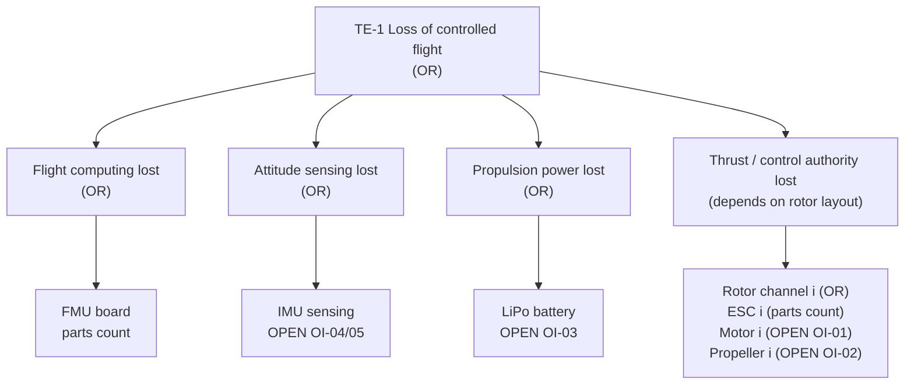
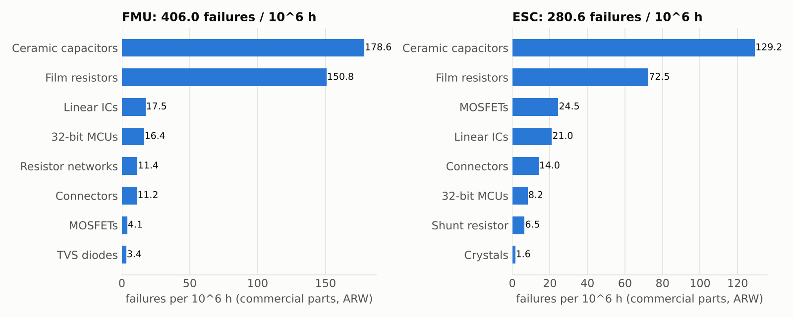
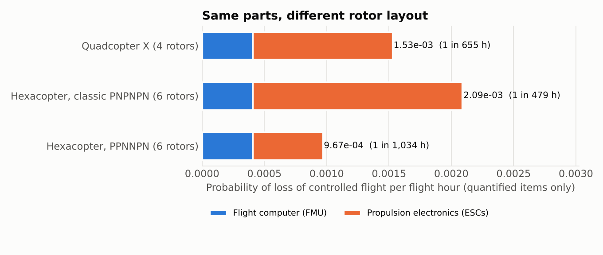
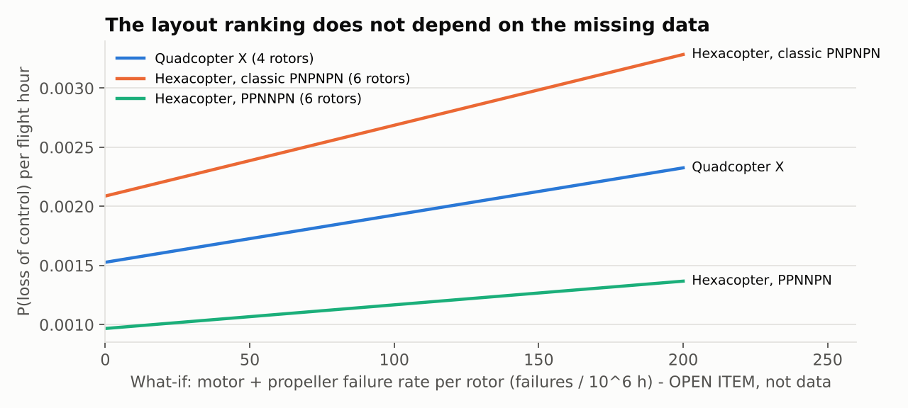

# Hexacopter Safety Analysis — Loss of Controlled Flight

**Rev A.1 · 17 November 2026 · Rendy Ryan Renaldi**
Portfolio study. Not a certification analysis.

---

## 1. Purpose and approach

This study asks one question: **how likely is a multirotor drone to lose controlled flight, and which design choices change that probability?**

It follows four rules:

1. **No unsupported numbers.** Every failure rate comes from a public bill of materials (BOM) and a published prediction method. Where no data exists, the item stays an **open item** and is not given a value.
2. **Failure rates come from component data.** Rates are in failures per 10⁶ hours (FPMH) and are converted to probability with the constant-failure-rate (exponential) model, P = 1 − e^(−λt). This model describes random failures during the useful-life part of the bathtub curve: a part that works today can still fail tomorrow.
3. **Top-down.** The fault tree starts at the hazard (Level 1), breaks it into subsystem functions (Level 2), and only then goes down to parts (Level 3). Levels 1–2 do not need a BOM.
4. **The goal is to reduce the probability of the hazard** to people, the environment and the drone itself. Each finding ends in a design option or a safety requirement.

## 2. System definition

| Item | What is used | Why this choice |
|---|---|---|
| Flight computer | Pixhawk **FMUv3 REV D** flight-management board (Pixhawk 2 FMU) | Its complete BOM (151 parts) is published under CC BY-SA 3.0 in the Pixhawk Hardware repository [3] |
| ESC (one per rotor) | **Sapog reference ESC** (STM32F105 + FAN7888 + 6× BSC019N04NS) | Its complete schematic is published in the same repository [3]; 86 electrical parts |
| Layouts compared | Quad X · Hexa classic **PNPNPN** · Hexa **PPNNPN** | Same parts, different rotor arrangement |
| Environment | MIL-HDBK-217F **ARW** (Airborne, Rotary Winged) | The handbook's closest description of a vibrating, rotary-wing airborne installation |
| Reporting unit | Probability per **flight hour** (1 h flight) | Standard aviation unit; the demo also shows other flight durations |

**Outside the boundary in Rev A:** ground operations (charging, maintenance), the ground control station, payload.

## 3. Level 1 — Hazards (top events)

| ID | Top event | Harm to people | Harm to environment | Harm to the drone | Rev A treatment |
|---|---|---|---|---|---|
| **TE-1** | **Loss of controlled flight** | Falling drone strikes people (MIL-STD-882E severity: Catastrophic) | Impact fire from the battery | Destroyed | **Quantified (partly)** |
| TE-2 | Battery thermal runaway / fire | Burns | Vegetation or building fire | Destroyed | Qualitative (OI-03) |
| TE-3 | Fly-away (navigation or command-link loss) | Strike outside the operating area | Crash in uncontrolled area | Lost | Qualitative (OI-10) |

## 4. Level 2 — Fault tree for TE-1 (no BOM needed)

How the thrust branch depends on the rotor layout (from published controllability analyses [4]–[7]):

| Layout | Single rotor loss | Gate used |
|---|---|---|
| Quad X | Not controllable | OR of 4 channels |
| Hexa classic PNPNPN | Not fully controllable after **any** single rotor loss [4][7] | OR of 6 channels |
| Hexa PPNNPN | Controllable after loss of rotor 1, 2, 3 or 4; not after rotor 5 or 6 [4][6] | OR(ch5, ch6, **≥2 of ch1–4**) |

For PPNNPN, every double failure is counted as loss of control. This is conservative. The tolerance credit is only valid if the flight software detects the failure and re-allocates control (**SR-02**), so it must be verified by test before it is claimed.

## 5. Level 3 — Data

### 5.1 Data hierarchy

Rates are taken in this order: (1) supplier or field data → (2) MIL-HDBK-217F Notice 2 parts count [1] → (3) **open item**. No public supplier data exists for the selected parts, so Rev A uses the parts count method:

λ_part = N · λ_g · π_Q   (π_L = 1 for mature microcircuits)

- **λ_g** is the generic failure rate for the ARW environment.
- **π_Q** is the quality factor. All parts in both designs are commercial grade: microcircuits π_Q = 10 ("other commercial or unknown screening levels", p. A-4), plastic discrete semiconductors 8.0 (p. A-6), "lower" grade resistors and capacitors 10 (pp. A-7, A-8), non-MIL connectors 2.0 and crystals 2.1 (p. A-11).
- **Every λ_g and π_Q was checked line by line against the handbook (Notice 2, Appendix A, pp. A-2 to A-11).** The page for each row is in `data/mil217f_partscount_ARW.csv`. The first draft took the values from the open-source RAMSTK tool [2]; the check confirmed 11 rows and corrected 10 rows plus one quality factor, mostly passive parts whose rates were revised in Notice 2.

### 5.2 Classification rules

These rules are applied wherever a datasheet does not settle the parts count row:

| Rule | Decision | Reason |
|---|---|---|
| C-1 | Linear/mixed-signal ICs whose transistor count is not published → highest linear bin (1,001–10,000) | Conservative |
| C-2 | Current-sense shunt → film, power (RD) row | Conservative; construction not specified in the schematic |
| C-3 | F-RAM → nearest MOS memory row (SRAM 64K–256K) | F-RAM has no row in the handbook |
| C-4 | USB ESD protection array → transient suppressor row | Function is transient suppression |
| C-5 | Resettable PTC fuse → fuse row | Closest function |
| C-6 | Board-mounted connectors (JST, micro-USB, microSD, board-to-board) → rectangular connector row | Notice 2 has no generic PCB-connector row |

Every BOM line, its row, its quantity and its note are in `data/bom_fmu_v3.csv` and `data/bom_esc_sapog.csv`. All 151 FMU BOM parts are accounted for: 148 are counted, and 3 MEMS sensors are excluded because the handbook has no MEMS row (OI-04).

### 5.3 Parts count results (commercial parts, ARW)

| Assembly | Parts counted | λ (failures / 10⁶ h) | MTBF (h) | Largest contributors |
|---|---|---|---|---|
| FMU board | 148 | **406.0** | ≈ 2,460 | ceramic capacitors 178.6 · chip resistors 150.8 · linear ICs 17.5 · two MCUs 16.4 |
| ESC (each) | 86 | **280.6** | ≈ 3,560 | ceramic capacitors 129.2 · chip resistors 72.5 · 6 power MOSFETs 24.5 · linear ICs 21.0 |

Passive parts dominate: ceramic capacitors and chip resistors make up 81% of the FMU rate and 72% of the ESC rate. This happens because the board has many of them (47 capacitors and 52 resistors on the FMU) and because the handbook applies π_Q = 10 to commercial ("lower" grade) passives.

## 6. Results for TE-1

Probability of loss of controlled flight per flight hour, **quantified items only** (FMU + ESCs):

| Layout | Commercial parts | vs quad | MIL-spec quality grade |
|---|---|---|---|
| Quad X | 1.53 × 10⁻³ (1 in 655 h) | 1.00× | 1.86 × 10⁻⁴ |
| Hexa classic PNPNPN | 2.09 × 10⁻³ (1 in 479 h) | **1.37×** | 2.56 × 10⁻⁴ |
| Hexa PPNNPN | 9.67 × 10⁻⁴ (1 in 1,034 h) | **0.63×** | 1.17 × 10⁻⁴ |

**Findings**

1. **Adding rotors is not automatically safer.** With the classic PNPNPN layout, the six ESCs act as six single points of failure, so the predicted probability is 37% higher than for the quadcopter.
2. **The same six rotors in a PPNNPN layout reduce the probability by 54% compared with PNPNPN** (37% compared with the quad), because only rotors 5 and 6 remain single points of failure.
3. **The ranking does not depend on the missing motor and propeller data.** Every layout carries the same open items per rotor, and the ordering holds for any value tested (0–1,000 FPMH per rotor; see the figure below and `tests/`).
4. **In the PPNNPN layout, the flight computer becomes the largest single contributor** (Fussell–Vesely importance 42%), so the next improvement should target it.
5. **Component quality grade is a strong lever, and passive parts matter most.** Moving from commercial to MIL-spec quality lowers the predicted rate by about 8–9× according to the handbook's π_Q values, and most of that gain comes from the capacitors and resistors. This is the "datasheet matters" point: the benefit of a specific upgrade should be confirmed with that supplier's own reliability data.

**Checks:** the analytic fault tree probability agrees with an independent Monte Carlo simulation (`results/monte_carlo_check.csv`, difference < 0.01 at 500 h). The browser demo reproduces the Python numbers to 10⁻⁹ relative error (`tests/test_analysis.py`).

## 7. Risk reduction and derived safety requirements

| ID | Requirement | Addresses | Effect in Rev A |
|---|---|---|---|
| SR-01 | Use a rotor layout that stays controllable after any single rotor loss covered by SR-02 (e.g., PPNNPN); do not use classic PNPNPN for flights over people | TE-1 | −56% vs PNPNPN |
| SR-02 | The flight software shall detect a rotor/ESC failure and re-allocate control; verify by hardware-in-the-loop and flight test before taking credit | TE-1 | Precondition for SR-01 |
| SR-03 | For flights over people, add a mitigation for the flight computer: a redundant flight computer or an independent flight termination system (parachute). Quantify it once supplier data is available | TE-1 | Targets the 42% contributor |
| SR-04 | Battery cell voltage and temperature monitoring with automatic return/land thresholds | TE-1, TE-2 | Open (OI-03) |
| SR-05 | Pre-flight propeller inspection and a replacement interval based on supplier fatigue data | TE-1 | Open (OI-02) |
| SR-06 | Part selection: use capacitors and resistors with a documented reliability grade (they are 72–81% of the predicted rate), apply derating to the ESC MOSFETs, and prefer higher-screened MCUs | TE-1 | Up to ~8–9× (π_Q) |

## 8. Open items and limitations

The full list is in `data/open_items.csv`. The most important ones:

- **V-01 (closed):** every λ_g and π_Q was checked against MIL-HDBK-217F Notice 2 Appendix A and its page recorded. Lesson: a secondary source (here RAMSTK) can carry values from an older revision, so always verify against the original document.
- **OI-01 to OI-05:** Motors, propellers, battery, MEMS sensors and the IMU/carrier boards are **not quantified**. The real probability is therefore **higher** than the values in Section 6. The comparison between layouts remains valid (Finding 3).
- **OI-08:** Parts count treats every part as critical, for example an indicator LED. It is an upper bound for TE-1. The next refinement is an **FMEDA**, which keeps only the failure modes that actually cause loss of control.
- MIL-HDBK-217F has not been updated since 1995 and is generally pessimistic for modern commercial parts [9]. **Treat the absolute numbers as conservative and the relative comparisons as the main result.**
- Mapping to the MIL-STD-882E probability levels [8] requires the program to define the item's life in flight hours. Rev A does not define it.

## 9. Next revision (Rev B)

1. FMEDA of the ESC and FMU (failure-mode split).
2. Obtain supplier data for the motor, propeller and battery (the handbook's generic motor row assumes a 10-year design life, which does not fit a drone motor).
3. Quantify TE-2 and TE-3; add common-cause failures for the redundant IMUs.

## References

1. MIL-HDBK-217F Notice 2, *Reliability Prediction of Electronic Equipment*, US DoD, 28 Feb 1995. Distribution A. https://everyspec.com/MIL-HDBK/MIL-HDBK-0200-0299/MIL-HDBK-217F_NOTICE-2_14590/
2. RAMSTK v0.19.0 (ReliaQual Associates), commit 68c1112 — used for the first draft only; superseded by the handbook check. https://github.com/ReliaQualAssociates/ramstk
3. Pixhawk Hardware repository, commit bbf3de5: `FMUv3_REV_D/BOM`, `sapog_reference_hardware/sapog_reference_hardware.sch`. CC BY-SA 3.0. https://github.com/pixhawk/Hardware
4. G.-X. Du, Q. Quan, K.-Y. Cai, *Controllability Analysis for Multirotor Helicopter Rotor Degradation and Failure*, arXiv:1403.5986.
5. G.-X. Du, Q. Quan, K.-Y. Cai, *Controllability Analysis and Degraded Control for a Class of Hexacopters Subject to Rotor Failures*, arXiv:1307.0276.
6. RPI MOVE Lab, *An Analysis of Classical and Alternate Hexacopter Configurations with Single Rotor Failure*. https://move.rpi.edu/node/354
7. J. I. Giribet, R. S. Sánchez-Peña, A. S. Ghersin, *Analysis and Design of a Tilted Rotor Hexacopter for Fault Tolerance*, IEEE Trans. Aerospace and Electronic Systems 52(4), 2016.
8. MIL-STD-882E, *System Safety*, US DoD, 2012.
9. The Aerospace Corporation, ATR-2024-02067, *Reliability Guidelines on Failure Rates for Space EEE Parts*, 2024.
